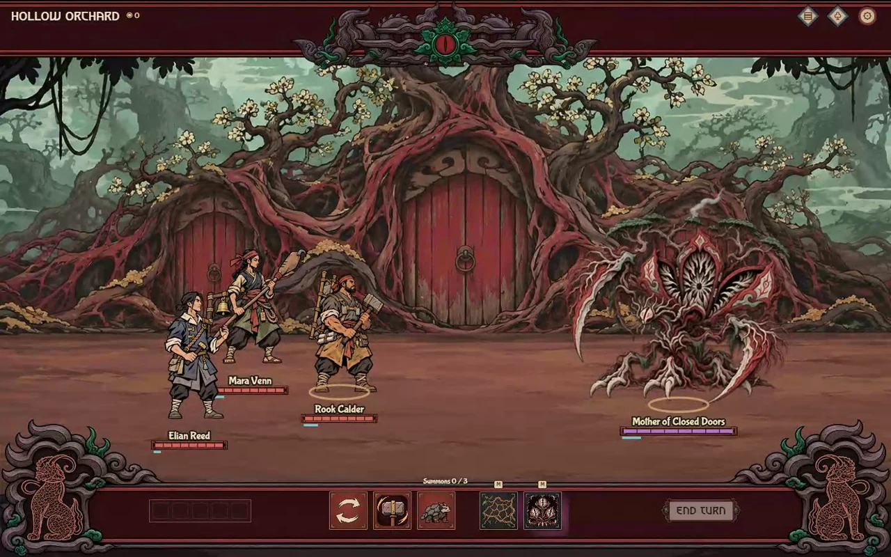

# VEILBOUND · The Broken Accord



The Waymarks once guided the dead beyond the Quiet Reach. When they broke, the keepers fed them stolen memories. In this tactical dice roguelike, a squad of wardens crosses five haunted regions to return the names the land has kept.

[Open the game](https://veilbound-testnet-web-2441d075.vercel.app/) · [Run locally](#run-locally) · [Living Journey](#living-journey) · [Inspect the Testnet record](#the-testnet-record)

*Boss encounter captured in a shortened game preview. Public deployment and on-chain checks are documented below.*

## Enter Hollow Orchard

**Pick a Talisman.** Sign in with a NEAR wallet or Google, then choose **New Game** and select a starting squad. The sign-in flow opens in a separate window. The campaign runs through Hollow Orchard, Drowned Causeway, Ember Terraces, Iron Mourning, and Pale Basin.

**Read both dice pools.** Select a die and resolve its action. Rotate to change the lead, use Guard before a dangerous hit, or summon a companion for two rounds. Each encounter allows up to three summons.

**Plan the next stop.** Collect loot, equip the squad and choose a route. Elite encounters offer a different risk and reward. Curses carry across battles in a run, and remedies compete with equipment and healing for the same Crowns. Open **Expedition** for rewarded-run preparation or **Marketplace** for trading, rentals and crafting. Wallet-signed actions require a verified NEAR testnet wallet.

### Game modes

- **Expedition**. Take a squad through branching routes, shops, elites, and five regional bosses.
- **Accord Trials**. Qualifying victories unlock trials with additional combat constraints. The game records completed trials automatically.
- **Weekly Oath**. Play a ranked attempt or practice under the weekly ruleset. Qualifying milestone rewards appear in Rewards automatically.
- **The Breach**. Take on the raid boss and contribute damage to a shared health pool. The game records damage and grants eligible rewards when the encounter ends.
- **Veil Duel**. Play a private room match or practice against a bot. Reopen your last room or result from the mode screen.
- **Co-op Breach**. Share an invite link. Invitees open it and select Join Room. The encounter begins once all three players are ready.

## From Expedition to the economy


*The loot panel shows the run balance, supplies and equipment. The current UI calls the run currency Crowns.*

The browser renders combat and handles input. For rewarded online runs, the game API keeps authoritative state and validates the action replay. NEAR contracts handle settlement, ownership, escrow and spending limits.

### Games With Real Economies

- **Crowns and Copper.** Earn and spend Crowns within an Expedition. Copper (COPPER) is the NEAR testnet token used for checkpoint rewards, trading and crafting. Select **Claim Copper** at an eligible checkpoint. If the claim requires a storage top-up, the wallet can approve both in one transaction. Core verifies the signed receipt and enforces claim and budget limits.
- **Materials and crafting.** Players can trade recovered materials or spend them on recipes. Core reserves funded balances for market orders, so the same Copper cannot back two open orders.
- **NPC procurement and Field Contracts.** Dedicated NPC accounts can post buy orders under bounded budgets. Field Contracts give players another reason to take an elite route before reaching the corresponding boss.

### NFTs That Do Something

- **Relic.** Adds an eligible loadout option. Choose **Start with Loadout** to reserve the selected Relic and Companion in one wallet transaction. Reservation and rental rules control who can equip them and when.
- **Chronicle.** Records eligible milestones that Core can check against evolution requirements.
- **Companion.** Represents a summon option that can be reserved for an eligible run. The encounter still enforces its summon rules.
- **Shop Charter.** Authorizes shop operations tied to an artifact vault. Core checks ownership and custody.

Relic owners sign their own evolution transactions. Core looks up the registered **Ascended** and **Legendary** recipes and checks the required Chronicle milestone, Copper, and materials. The project administrator registers each recipe once.

## Living Journey

The Living Journey plan connects story choices, combat, the player economy, and the record each Expedition leaves behind.

| Feature | What players can do | Release status |
| --- | --- | --- |
| Story encounters across five regions | Inspect scenes, talk to NPCs, and take optional actions with a cost or a consequence. In Hollow Orchard, carry the Lost Letter, learn who should receive it, and deliver it before facing the Mother of Closed Doors to weaken her opening defense. | Story effects are wired into boss entry. A deterministic run cleared all five regions. Full browser playthrough and visual review remain open. |
| NPC memory and dialogue | NPC responses draw on the current Expedition and eligible choices. The rules validate offers and apply their effects. | Contextual dialogue and authored fallback are implemented. Live NEAR AI inference and production budget verification remain pending. |
| NFT loadout | Pick eligible Relics and Companion Bonds from inventory, compare the dice outcomes, or try the sample loadout. A bonded Companion can replace its warden's Strike with Summon when that warden leads. Relic upgrades follow the staged evolution recipes. | Loadout selection and bundled reservation are deployed. The combined wallet transaction and player-signed rental still need end-to-end testnet receipts. |
| Professions and crafting | Unlock Apothecary, Relicsmith, and Binder through Expedition checkpoints. Use recipes or commissions to turn materials into supplies and services. | Profession progression, crafting and craft-order paths have local or sandbox coverage. Live player commission settlement remains open. |
| Shop Charter and NPC procurement | View Charter stock, fund the shop vault, and place Copper orders. NPC operators can procure materials with scoped keys, finite budgets, and price limits. Field Contracts pay after a verified objective and checkpoint. | Finalized NPC buy orders and cancellations are recorded. Player fills, Charter service and retail transactions, and Field payouts still need public player receipts. |
| Copper accounting | Rewards draw from capped allocations. Marketplace and Charter orders reserve funds in escrow. Copper, materials, supplies, and settlement are tracked separately. | Reward caps and settlement paths have test coverage. Sustained economy telemetry and live player settlement remain open. |
| Chronicle and replay | Record eligible milestones, share a run summary, jump to key moments in its replay, and try the same route as a challenge. Chronicle requirements feed into Relic evolution. | Replay verification and sharing are implemented. Player-recorded Chronicle and evolution transactions still need public receipts. |
| Onboarding and presentation | Use the first-battle guide, preview the loadout, and read story effects as the boss enters. Claim Starter Packs and rewards from the Expedition Kit. Marketplace actions open the wallet directly and material orders publish after confirmation. | The public frontend serves the simplified signing flow. Full new-player usability testing and a fresh wallet-signed end-to-end run remain open. |

Guest sessions and Starter Packs support onboarding. Google sign-in is offered by the public configuration. The checkout can use a direct wallet transaction and preview a Tidepool quote. Public NEAR Auth/MPC signing and NEAR Intents settlement remain pending. Ranked Duel is configurable locally. Custom Duel and Co-op Breach completed local browser matches.

A full release check follows an Expedition from an NPC encounter through supplies or services, a decision, the boss, the Chronicle, and a shared replay. Local tests, sandbox settlements, public UI checks, and finalized testnet transactions each cover parts of that route.

## The Testnet record

**Network:** NEAR testnet. Contract state was rechecked at finalized blocks **277724718–277724719** on **November 15, 2026 (UTC+7)**. The public API returned healthy, Core was active, Copper metadata returned ticker `COPPER` with two decimals, and both Relic recipe views returned data.

### Deployed contracts and vaults

Core serves the artifact collection. Its reusable Vault template creates per-artifact subaccounts, giving the Starter Relic and Shop Charter separate custody addresses.

| What to inspect | Verified result | Evidence |
| --- | --- | --- |
| Copper fungible token | `copper.vibebound.testnet` serves fungible-token metadata. Initial setup recorded a matching 1,000 Copper supply, custody balance and allocation. | [Copper account](https://testnet.nearblocks.io/address/copper.vibebound.testnet) · [Setup verification](deployments/testnet.setup.verified.json) |
| Core contract | `core.vibebound.testnet` is active. The prior unpause and code verification were recorded. | [Core account](https://testnet.nearblocks.io/address/core.vibebound.testnet) · [Unpause transaction](https://testnet.nearblocks.io/txns/GLHo6Mx1WVFCwE7Rs58cvQaSN5UNNBeoUpvjcX4QEFUp) · [Upgrade record](deployments/nft-run-lock/testnet.unpause.verified.json) |
| Starter Relic and Shop Charter | Setup verified NFT ownership and zero access keys on the two vaults. The Starter Relic still returned `ready` on the recheck. | [Starter vault](https://testnet.nearblocks.io/address/v-starter-001.core.vibebound.testnet) · [Shop vault](https://testnet.nearblocks.io/address/v-shop-001.core.vibebound.testnet) · [Setup verification](deployments/testnet.setup.verified.json) |

### Finalized transactions and state

| What to inspect | Verified result | Evidence |
| --- | --- | --- |
| Starter Pack wallet link | Core finalized the link for `starter-001`. A separate wallet transaction completes the claim. | [Link transaction](https://testnet.nearblocks.io/txns/B4GoriiJZCwRVucPfdE2MHHrc8YopFuCw2cV8FgSc51g) |
| NPC procurement | The Provisioner’s `place_market_order` finalized successfully with zero failed receipts. The pilot also recorded the unfilled order’s cancellation. | [Order transaction](https://testnet.nearblocks.io/txns/6Y2Jiq16DYk3Jd9x836pGqPFNmn61tfqos3L1omY36ZR) · [Pilot evidence](evidence/testnet/npc-market-pilot.verified.json) |
| Relic evolution | Two `register_evolution_recipe` calls finalized successfully with zero failed receipts. Both stages are readable on Core. | [Recipe transaction](https://testnet.nearblocks.io/txns/J8XqiZu1gA5xw1Z9Zr9QnyUsh1CMNs2dJibsZRTfuwAK) · [Receipt](evidence/testnet/evolution-0-J8XqiZu1gA5xw1Z9Zr9QnyUsh1CMNs2dJibsZRTfuwAK.json) |
| Material reward budgets | Ten material and regional trophy budgets were confirmed after configuration. | [Configuration transaction](https://testnet.nearblocks.io/txns/27GYBK7xBQCFs9WrQQ64CY34CpeoX2zVFUoaTDvXNyeo) · [Budget evidence](deployments/economy/testnet.material-budgets.verified.json) |
| Field Contract escrow | The operator reserved and released 2.50 Copper. A finalized `get_field_reward` view returned `released`. | [Operator account](https://testnet.nearblocks.io/address/field.vibebound.testnet) · [Reserve and release evidence](evidence/testnet/field-reserve-release-smoke.json) |

The public receipts above cover contract activation, setup, order placement, recipe registration and reserve/release. A public player checkpoint payout, a player fill of an NPC order, and a player Relic evolution each need their own finalized receipt. Local tests cover additional flows described below.

<details>
<summary>Re-run the transaction and contract checks</summary>

To reproduce the transaction lookup from PowerShell:

```powershell
$body = @{
  jsonrpc = '2.0'
  id = 'veilbound-proof'
  method = 'tx'
  params = @{
    tx_hash = '6Y2Jiq16DYk3Jd9x836pGqPFNmn61tfqos3L1omY36ZR'
    sender_account_id = 'provisioner.vibebound.testnet'
    wait_until = 'FINAL'
  }
} | ConvertTo-Json -Depth 5

$proof = Invoke-RestMethod -Method Post -Uri 'https://test.rpc.fastnear.com' `
  -ContentType 'application/json' -Body $body
$proof.result.final_execution_status
$proof.result.status
$proof.result.receipts_outcome | ForEach-Object { $_.outcome.status }
```

For contract reads, call NEAR RPC `query` with `request_type: call_function` and `finality: final`. On Core, check `is_paused`, `get_artifact` with `{"token_id":"starter-001"}`, or `get_evolution_recipe` with stage `1` or `2`. Encode arguments as Base64 JSON. [NEAR transaction RPC](https://docs.near.org/api/rpc/transactions)

</details>

## Run locally

Use Node.js 24 and npm. Run the following from this directory.

```sh
npm ci
npm --prefix server ci
node scripts/start-local-preview.mjs
```

Open [the local game](http://127.0.0.1:8787/expedition.html), [Expedition](http://127.0.0.1:8787/online-expedition.html), or [Game Modes](http://127.0.0.1:8787/modes.html). The preview uses a temporary database by default and a local starter adapter.

```sh
npm run test:backend
npm run test:gameplay
```

The November 17 development checkout passed **98 backend tests** and **61 gameplay tests**, with the opt-in PostgreSQL test skipped. The deterministic [five-region win](evidence/gameplay/five-region-win.json) and [region-two defeat](evidence/gameplay/region-two-loss.json) are replay records. These counts are reproducible from this release.

See [operating instructions](docs/implementation/OPERATIONS.md) for testnet configuration.

<details>
<summary>Source map and architecture</summary>

| Layer | Responsibility | Source |
| --- | --- | --- |
| Browser | Combat presentation, input, map, shops and marketplace. Canvas and Three.js render the combat sprites and effects. The public client is hosted on Vercel. | [Expedition client](expedition.mjs) · [Combat renderer](expedition-art.mjs) |
| Rules engine | Deterministic dice, targeting, formation, curses, consumables, combat resolution and map progression. | [Expedition rules](expedition-rules.mjs) |
| Game API | Sessions, authoritative online run state, replay validation, receipt preparation, economy adapters and realtime rooms. The public API is hosted on Railway. | [HTTP API](server/src/http.mjs) · [Server entry](server/src/main.mjs) |
| NEAR contracts | Copper supply, receipt settlement, balances, escrow, NFT ownership and the vault template. | [Copper](contracts/copper) · [Core](contracts/core) · [Vault](contracts/vault) |

Online dice actions and VFX run through the game’s client and server. NEAR handles durable outcomes where ownership, payment or custody matters. Authorized reward receipts bridge the server’s replay validation to Core’s settlement checks.

</details>
