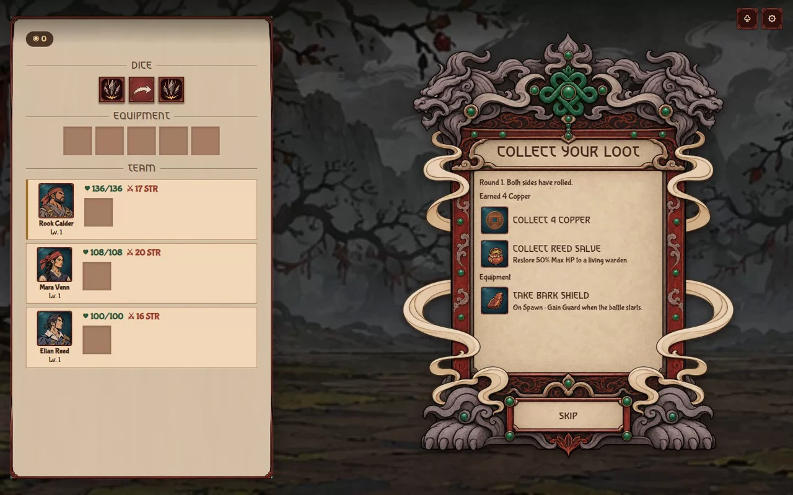

# VEILBOUND · The Broken Accord


The Waymarks once guided the dead beyond the Quiet Reach. When they broke, the keepers fed them stolen memories. In this tactical dice roguelike, a squad of wardens crosses five haunted regions to return the names the land has kept.

[Open the game](https://veilbound-testnet-web-2441d075.vercel.app/) · [Run locally](#run-locally) · [Living Journey](#living-journey) · [NEAR testnet contracts](#near-testnet-contracts)

## Enter Hollow Orchard

**Pick a Talisman.** Sign in with a NEAR wallet or Google, then choose **New Game** and select a starting squad. The sign-in flow opens in a separate window. The campaign runs through Hollow Orchard, Drowned Causeway, Ember Terraces, Iron Mourning, and Pale Basin.

**Read both dice pools.** Select a die and resolve its action. Rotate to change the lead, use Guard before a dangerous hit, or summon a companion for two rounds. Each encounter allows up to three summons.

**Plan the next stop.** Collect loot, equip the squad and choose a route. Elite encounters offer a different risk and reward. Curses carry across battles in a run, and remedies compete with equipment and healing for the same pool of Crowns. Open **Expedition** for rewarded-run preparation or **Marketplace** for trading, rentals and crafting. Wallet-signed actions require a verified NEAR testnet wallet.

### Game modes

- **Expedition**. Take a squad through branching routes, shops, elites, and five regional bosses.
- **Accord Trials**. Qualifying victories unlock trials with additional combat constraints. The game records completed trials automatically.
- **Weekly Oath**. Play a ranked attempt or practice under the weekly ruleset. Qualifying milestone rewards appear in Rewards automatically.
- **The Breach**. Take on the raid boss and contribute damage to a shared health pool. The game records damage and grants eligible rewards when the encounter ends.
- **Veil Duel**. Play a private room match or practice against a bot. Reopen your last room or result from the mode screen.
- **Co-op Breach**. Share an invite link. Invitees open it and select Join Room. The encounter begins once all three players are ready.

## From Expedition to the economy



*The loot panel shows the run balance, supplies and equipment.*

The browser renders combat and handles input. For rewarded online runs, the game API keeps authoritative state and validates the action replay. NEAR contracts handle settlement, ownership, escrow and spending limits.

### Games With Real Economies

- **Crowns and Copper.** Earn and spend Crowns within an Expedition. Copper (COPPER) is the NEAR testnet token used for checkpoint rewards, trading and crafting. Select **Claim Copper** at an eligible checkpoint. If the claim requires a storage top-up, the wallet can approve both in one transaction. Core verifies the signed receipt and enforces claim and budget limits.
- **Materials and crafting.** Players can trade recovered materials or spend them on recipes. Core reserves funded balances for market orders, so the same Copper cannot back two open orders.
- **NPC procurement and Field Contracts.** Dedicated NPC accounts can post buy orders under bounded budgets. Field Contracts give players another reason to take an elite route before reaching the corresponding boss.

### NFTs That Do Something

- **Relic.** Adds an eligible loadout option. Choose **Start with Loadout** to reserve the selected Relic and Companion in one wallet transaction. Reservation and rental rules control who can equip them and when.
- **Chronicle.** Records eligible milestones that Core can check against evolution requirements.
- **Companion.** Represents a summon option that can be reserved for an eligible run. The encounter still enforces its summon rules.
- **Shop Charter.** Authorizes shop operations tied to an artifact vault. Core checks ownership and custody.

Relic owners sign their own evolution transactions. Core looks up the registered **Ascended** and **Legendary** recipes and checks the required Chronicle milestone, Copper, and materials. The project administrator registers each recipe once.

## Living Journey

Living Journey connects story choices, combat, the player economy, and the record each Expedition leaves behind.

| Feature | What players can do  |
| --- | ---  |
| Story encounters across five regions | Inspect scenes, talk to NPCs, and take optional actions with a cost or a consequence. In Hollow Orchard, carry the Lost Letter, learn who should receive it, and deliver it before facing the Mother of Closed Doors to weaken her opening defense.  |
| NPC memory and dialogue | NPC responses draw on the current Expedition and eligible choices. The rules validate offers and apply their effects.  |
| NFT loadout | Pick eligible Relics and Companion Bonds from inventory, compare the dice outcomes, or try the sample loadout. A bonded Companion can replace its warden's Strike with Summon when that warden leads. Relic upgrades follow the staged evolution recipes.  |
| Professions and crafting | Unlock Apothecary, Relicsmith, and Binder through Expedition checkpoints. Use recipes or commissions to turn materials into supplies and services.  |
| Shop Charter and NPC procurement | View Charter stock, fund the shop vault, and place Copper orders. NPC operators can procure materials with scoped keys, finite budgets, and price limits. Field Contracts pay after a verified objective and checkpoint.  |
| Copper accounting | Rewards draw from capped allocations. Marketplace and Charter orders reserve funds in escrow. Copper, materials, supplies, and settlement are tracked separately.  |
| Chronicle and replay | Record eligible milestones, share a run summary, jump to key moments in its replay, and try the same route as a challenge. Chronicle requirements feed into Relic evolution.  |
| Onboarding and presentation | Use the first-battle guide, preview the loadout, and read story effects as the boss enters. Claim Starter Packs and rewards from the Expedition Kit. Marketplace actions open the wallet directly and material orders publish after confirmation.  |

Guest sessions and Starter Packs support onboarding. Players can sign in with Google or use a NEAR testnet wallet to approve transactions. Checkout also offers a Tidepool quote preview.

## NEAR testnet contracts

- [Copper token](https://testnet.nearblocks.io/address/copper.vibebound.testnet) supplies COPPER, the testnet token used in the player economy.
- [Core](https://testnet.nearblocks.io/address/core.vibebound.testnet) serves the NFT collection and handles reward settlement, escrow, and custody. Its Vault template gives assets such as the Starter Relic and Shop Charter their own custody addresses.

## Run locally

Use Node.js 24 and npm. Run the following from this directory.

```sh
npm ci
npm --prefix server ci
node scripts/start-local-preview.mjs
```

Open [the local game](http://127.0.0.1:8787/expedition.html), [Expedition](http://127.0.0.1:8787/online-expedition.html), or [Game Modes](http://127.0.0.1:8787/modes.html). The preview uses a temporary database by default and a local starter adapter.

See [operating instructions](docs/implementation/OPERATIONS.md) for testnet configuration.

<details>
<summary>Source map and architecture</summary>

| Layer | Responsibility | Source |
| --- | --- | --- |
| Browser | Combat presentation, input, map, shops and marketplace. Canvas and Three.js render the combat sprites and effects. The public client is hosted on Vercel. | [Expedition client](expedition.mjs) · [Combat renderer](expedition-art.mjs) |
| Rules engine | Deterministic dice, targeting, formation, curses, consumables, combat resolution and map progression. | [Expedition rules](expedition-rules.mjs) |
| Game API | Sessions, authoritative online run state, replay validation, receipt preparation, economy adapters and realtime rooms. The public API is hosted on Railway. | [HTTP API](server/src/http.mjs) · [Server entry](server/src/main.mjs) |
| NEAR contracts | Copper supply, receipt settlement, balances, escrow, NFT ownership and the vault template. | [Copper](contracts/copper) · [Core](contracts/core) · [Vault](contracts/vault) |

Online dice actions and VFX run through the game’s client and server. NEAR handles durable outcomes where ownership, payment or custody matters. Authorized reward receipts bridge the server’s replay validation to Core’s settlement checks.

</details>
